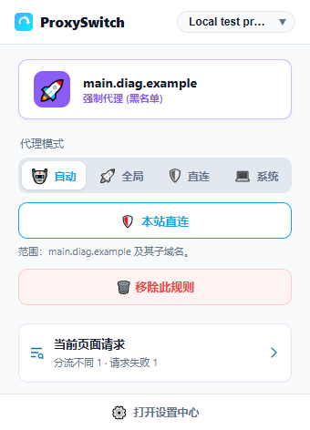
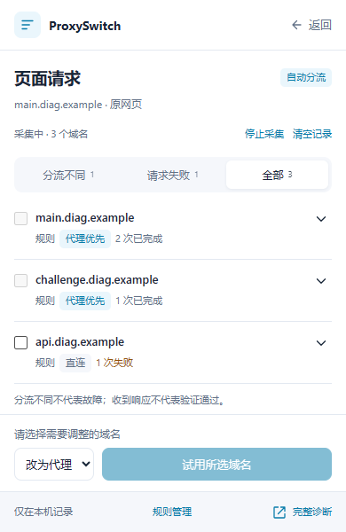

# ProxySwitch

Chrome 代理切换、域名分流与页面请求诊断工具。

A Chrome extension for proxy switching, domain routing, and page request diagnostics.

<!-- 动态读取 main 分支 manifest.json 的版本号 -->


[中文说明](#中文说明) | [English](#english) | [下载 / Download](https://github.com/DMSQ-creator/ProxySwitch/releases/latest) | [更新说明 / Changelog](CHANGELOG.md) | [隐私政策 / Privacy](Privacy.md)

---

## 中文说明

**ProxySwitch** 基于 Chrome Manifest V3，支持自动分流（PAC）、全局代理、直连和系统代理四种模式。您可以在弹窗添加代理或直连规则，查看页面使用的第三方域名，并先试用再保存规则。

扩展需要 Chrome 95 或更高版本。它负责管理浏览器代理设置；使用代理前，请先准备可用的代理服务器，例如 Clash 的本地监听地址。

### ✨ 主要功能

*   **🛡️ 多模式切换**：支持自动分流 (PAC)、全局代理、直接连接、系统代理四种模式一键切换。
*   **🤖 智能分流**：
    *   **GFWList 支持**：一键订阅并更新 GFWList 规则。
    *   **自动识别**：根据域名自动判断走代理还是直连。
    *   **黑白名单**：支持自定义强制代理域名（黑名单）和强制直连域名（白名单）。
    *   **本站直连**：在弹窗一键将当前域名及其子域名加入白名单，加载中的网页也可操作；支持撤销，保留原有代理规则。白名单仅在自动分流模式下生效。
*   **🔎 当前页面请求诊断**：主动开启后，按域名查看当前页面的请求、规则线路与错误；支持批量临时试用代理/直连、撤销及保存正式规则。弹窗用于快速处理，详细页用于查看完整记录。
*   **🧰 故障黑匣子**：记录扩展启动、弹窗和代理应用的关键阶段，设置页可复制诊断报告，便于排查扩展自身的故障。
*   **☁️ 云端备份**：
    *   支持 **GitHub Gist** 备份（推荐，免费且稳定）。
    *   支持 **WebDAV** 备份（坚果云、Nextcloud 等）。
    *   配置以可读 JSON 保存到您自己的私有 GitHub Gist 或 WebDAV；同步凭据不会写入备份，但配置文件不会被额外加密，请使用可信服务和 HTTPS。
*   **⚡ 高级特性**：
    *   支持多个代理服务器配置及切换。
    *   内置服务器延迟测试。
    *   深色模式 (Dark Mode) 支持。
    *   支持跟随浏览器语言、简体中文、英文、西班牙语和俄语。

### 📂 目录结构

以下是主要目录结构。安装时请保留整个发布包，避免遗漏页面、语言包或脚本：

```text
ProxySwitch/
├── manifest.json             # 扩展配置与权限
├── CHANGELOG.md              # 中英双语更新说明
├── Privacy.md                # 正式隐私政策
├── _locales/                 # en、zh_CN、es、ru 语言包
├── assets/
│   ├── icon.png              # 扩展主图标
│   ├── icons/                # 各模式的静态图标
│   ├── diagnostics.css       # 页面诊断样式
│   └── screenshots/          # README 界面截图
├── html/
│   ├── popup.html
│   ├── options.html
│   └── diagnostics.html
├── js/
│   ├── background.js         # 后台与代理设置
│   ├── popup.js
│   ├── options.js
│   ├── utils.js
│   ├── routing.js            # PAC 与诊断共享的规则匹配
│   ├── diagnostics-background.js
│   ├── diagnostics.js
│   ├── diagnostics-i18n.js
│   ├── logger.js             # 故障黑匣子
│   ├── page-boot.js          # 页面早期启动记录
│   └── icon-data.js          # 预生成图标数据
├── tests/                    # 自动化测试，仅源代码仓库包含
└── tools/                    # 开发工具，仅源代码仓库包含
```

### 🚀 安装指南

从 GitHub 安装时，使用浏览器的“加载已解压的扩展程序”：

1.  **获取代码**
    打开[最新发布页](https://github.com/DMSQ-creator/ProxySwitch/releases/latest)，在 Assets 中下载 `ProxySwitch-v版本号.zip` 并解压。开发者也可以克隆仓库：
    ```bash
    git clone https://github.com/DMSQ-creator/ProxySwitch.git
    ```

2.  **打开扩展管理页**
    在 Chrome 地址栏输入以下地址并回车：
    ```text
    chrome://extensions/
    ```

3.  **开启开发者模式**
    点击页面右上角的开关，开启 **开发者模式 (Developer mode)**。

4.  **加载扩展**
    点击左上角的 **加载已解压的扩展程序 (Load unpacked)** 按钮。

5.  **选择文件夹**
    在弹出的窗口中，选择包含 `manifest.json` 的 `ProxySwitch` 文件夹即可。

**更新已有的本地安装：** 下载新版并解压，将新版文件覆盖到原先加载的目录，再到 `chrome://extensions/` 点击 ProxySwitch 的重新加载按钮。使用 Git 克隆安装的用户可更新仓库后重新加载。保留原目录和已安装的扩展即可沿用配置；更新前也可在设置页备份规则或配置。

### 📖 使用说明

1.  **配置服务器**：
    *   安装后，点击扩展图标或右键选择“选项”。
    *   进入“服务器配置”，添加你的 SOCKS5 或 HTTP 代理服务器地址。
    *   选择要使用的服务器，可通过“测试延迟”检查测试目标的连通情况。

2.  **切换模式**：
    *   点击浏览器右上角的扩展图标打开 Popup 面板。
    *   **🤖 自动分流**：根据规则判断（推荐日常使用）。
    *   **🚀 全局代理**：浏览器使用所选代理服务器，不按扩展的域名列表分流。
    *   **🛡️ 直接连接**：浏览器使用直连模式。
    *   **💻 系统代理**：浏览器遵循操作系统的代理配置。

    系统代理与自动分流是两个独立模式。自动分流中，匹配代理规则的请求发往所选服务器，未匹配的请求默认直连；第三方域名不会自动跟随主站。

3.  **添加规则**：
    *   在弹窗添加当前域名的永久代理规则，或点击“本站直连”加入白名单。
    *   “本站直连”适用于当前域名及其子域名；撤销白名单不会删除原有代理规则。
    *   域名规则在自动分流模式下生效。白名单优先于代理规则，本地地址优先直连；可在“规则管理”中处理已有规则及冲突。

4.  **云端备份**：
    *   在设置页面的“云端备份”中，填入 GitHub Token 或 WebDAV 信息即可备份/恢复配置。

5.  **语言与主题**：
    *   打开“设置 → 通用设置”，选择语言及跟随系统、浅色或深色主题。
    *   语言选择优先于浏览器默认语言；例如 Chrome 使用英文时，仍可将插件设置为简体中文。

### 图标含义

工具栏图标表示当前模式，或自动分流中当前页面主域名的规则结果。页面内的第三方请求可能使用其他线路，可在“当前页面请求”中查看。

| 图标 | 含义 |
| --- | --- |
|  紫色 G | 全局代理 |
|  蓝色 D | 直接连接 |
|  灰色 S | 系统代理 |
|  灰色 A | 自动模式默认直连，或尚无可识别的页面域名 |
|  绿色 A | 自动模式命中订阅代理规则 |
|  蓝色 W | 自动模式命中白名单、本地直连或诊断直连试用 |
|  橙色 T | 自动模式命中临时代理列表或诊断代理试用 |
|  紫色 M | 自动模式命中手动代理规则 |

### 🔎 排查页面的跨域请求

页面可能同时使用主站、验证码、登录、接口及静态资源等多个域名。自动分流按每个请求的目标域名匹配规则，不会让第三方域名自动跟随主站。

1. 在需要排查的普通 HTTP/HTTPS 页面打开扩展，点击“当前页面请求”。首次使用需允许可选的请求观察权限；默认不采集，无痕标签页不支持。
2. 点击重新加载并采集。扩展仅观察选中的标签页，每次最多采集 60 秒；开启前的历史请求无法补查。页面诊断绑定原标签页，打开详细页不会更换采集目标。
3. 查看全部域名，或筛选与主站规则线路不同的域名。勾选要验证的域名，选择代理或直连，然后临时应用并回网页验证。试用需要自动分流模式，不会替您切换代理模式；遇到已有手动规则冲突时需先处理冲突。
4. 有效时保存为正式规则，无效时撤销。试用最长 10 分钟，撤销只删除本次试用，不还原或覆盖期间修改的正式配置。

**请注意：**

* 显示的是依据 ProxySwitch 规则计算的线路，并非对实际出口 IP 的探测；代理回退及 Clash 内部规则也可能影响最终线路。
* 请求失败不一定需要代理，HTTP 成功也不代表验证码或登录验证通过。分流不同只是排查线索，不会自动添加规则。
* **域名规则不是按标签页隔离的：试用与保存都会影响其他页面对同一域名及其子域名的访问。**
* 采集最多保留 200 个域名，并限制进行中请求数量。记录仅包含域名、资源类型、计数、HTTP 状态与错误等摘要，不保存完整 URL、Cookie 或请求正文；本地记录在 30 分钟后清理，也可手动清除。
* 采集记录与临时试用不参加导出或云备份；您主动保存的正式规则遵循原有的配置备份/同步行为。

例如，主站 `www.69shuba.com` 走代理时，验证码域名 `challenges.cloudflare.com` 仍会单独匹配规则。可以先采集页面请求，再选择相关域名试用代理，并回到网页实际验证；扩展不会自动为所有 Cloudflare 请求添加代理规则，也不保证验证码通过。

### 故障排查与反馈

如果扩展弹窗无响应或代理切换异常：

1. 右键扩展图标打开“选项”，进入“通用设置 → 故障黑匣子”。弹窗打不开时，也可从 `chrome://extensions/` 中的扩展详情进入扩展选项。
2. 如需复现，勾选“记录成功操作的性能耗时”，重现问题后点击“复制诊断报告”。
3. 在 [GitHub Issues](https://github.com/DMSQ-creator/ProxySwitch/issues) 中提供浏览器及扩展版本、代理模式、复现步骤和报告。如果页面也无法打开，可同时提供扩展管理页显示的错误信息。

黑匣子报告显示最近 500 条运行事件和 20 次 Worker 启动记录，仅保存在本机。报告不包含服务器、规则或 PAC 正文，并会隐藏密码、Token 和完整网页 URL。配置读取失败时，设置页会进入只读诊断模式，以保护现有设置；仍可尝试复制报告，然后重新打开设置页。

### 权限与隐私

| 权限 | 用途 |
| --- | --- |
| `proxy` | 切换浏览器代理模式、应用所选服务器与 PAC 分流规则 |
| `storage` | 本地保存服务器、规则、界面偏好及诊断摘要 |
| `tabs` | 获取当前页面域名、绑定诊断目标，并在用户操作时刷新或返回原页面 |
| `alarms` | 结束到期的采集、清理过期试用状态与诊断记录 |
| `webRequest`（可选） | 首次采集时申请，随后仅在用户主动采集期间只读观察指定标签页的请求 |
| HTTP/HTTPS 主机访问 | 更新用户指定的订阅、测试延迟、访问用户配置的备份服务，以及配合请求诊断观察权限 |

页面请求诊断默认关闭，摘要仅本地暂存。云备份由用户主动配置，使用可读 JSON，GitHub Token 和 WebDAV 认证凭据不会写入备份；备份没有额外加密。完整说明见[隐私政策](Privacy.md)。

---

## English

**ProxySwitch** is a Chrome Manifest V3 extension with four modes: Auto (PAC), Global Proxy, Direct, and System Proxy. Add proxy or direct rules from the popup, inspect third-party domains used by a page, and try routing changes before saving them.

Requires Chrome 95 or later. The extension manages the browser's proxy settings; configure a working proxy server first, such as Clash's local listening address.

### ✨ Key Features

*   **🛡️ Multi-Mode Switching**: One-click switching between Auto Switch (PAC), Global Proxy, Direct Connection, and System Proxy modes.
*   **🤖 Smart Routing**:
    *   **GFWList Support**: Subscribe to and update GFWList rules with one click.
    *   **Auto Detection**: Automatically decides whether to proxy or connect directly based on the domain.
    *   **Black/White Lists**: Support for custom user rules (blacklist for forced proxy, whitelist for forced direct).
    *   **Direct for This Site**: Add the current hostname and its subdomains to the direct list from the popup, even while a page is loading. Undo removes the entry while keeping existing proxy rules. Direct-list rules apply only in Auto mode.
*   **🔎 Page Request Diagnostics**: Start a capture to inspect the current page's request domains, predicted rule routes, and errors. Try proxy/direct rules in batches, undo a trial, or save permanent rules. Use the popup for quick changes and the detailed view for the full record.
*   **🧰 Fault Black Box**: Records key extension startup, popup, and proxy-application milestones. Copy a diagnostic report from Options to help troubleshoot extension failures.
*   **☁️ Cloud Backup**:
    *   Supports **GitHub Gist** backup (Recommended).
    *   Supports **WebDAV** backup (Nextcloud, etc.).
    *   Configurations are stored as readable JSON in your own private GitHub Gist or WebDAV service. Sync credentials are excluded, but the backup is not additionally encrypted; use a trusted service and HTTPS.
*   **⚡ Advanced Features**:
    *   Configure and switch between multiple proxy servers.
    *   Built-in server latency testing.
    *   Dark Mode support.
    *   Follow the browser language, or choose Simplified Chinese, English, Spanish, or Russian.

### 📂 Directory Structure

The main directory structure is shown below. Keep the complete release package when installing so that pages, language packs, and scripts are available:

```text
ProxySwitch/
├── manifest.json             # Extension configuration and permissions
├── CHANGELOG.md              # Bilingual release notes
├── Privacy.md                # Official privacy policy
├── _locales/                 # en, zh_CN, es, ru language packs
├── assets/
│   ├── icon.png              # Main extension icon
│   ├── icons/                # Static mode icons
│   ├── diagnostics.css       # Request inspector styles
│   └── screenshots/          # README screenshots
├── html/
│   ├── popup.html
│   ├── options.html
│   └── diagnostics.html
├── js/
│   ├── background.js         # Background and proxy settings
│   ├── popup.js
│   ├── options.js
│   ├── utils.js
│   ├── routing.js            # Shared PAC/diagnostic matching
│   ├── diagnostics-background.js
│   ├── diagnostics.js
│   ├── diagnostics-i18n.js
│   ├── logger.js             # Fault black box
│   ├── page-boot.js          # Early page startup records
│   └── icon-data.js          # Pre-generated icon data
├── tests/                    # Automated tests; source repository only
└── tools/                    # Development tools; source repository only
```

### 🚀 Installation Guide

For installation from GitHub, use your browser's **Load unpacked** option:

1.  **Download Code**
    Open the [latest release](https://github.com/DMSQ-creator/ProxySwitch/releases/latest), download `ProxySwitch-vVERSION.zip` from Assets, and extract it. Developers can also clone the repository:
    ```bash
    git clone https://github.com/DMSQ-creator/ProxySwitch.git
    ```

2.  **Open Extensions Page**
    Type the following in your Chrome address bar:
    ```text
    chrome://extensions/
    ```

3.  **Enable Developer Mode**
    Toggle on **Developer mode** in the top right corner.

4.  **Load Extension**
    Click the **Load unpacked** button in the top left corner.

5.  **Select Folder**
    Select the `ProxySwitch` folder containing the `manifest.json` file.

**Update an existing unpacked installation:** Download and extract the new release, copy its files into the directory originally loaded, then click ProxySwitch's reload button on `chrome://extensions/`. Git installations can update the repository and reload the extension. Keeping the original directory and installed extension preserves its settings; you can also back up rules or configuration in Options before updating.

### 📖 Usage

1.  **Configure Server**:
    *   After installation, click the extension icon or right-click and select "Options".
    *   Go to "Server Configuration" and add your SOCKS5 or HTTP proxy server.
    *   Select the server to use. **Test Latency** checks connectivity to the test target.

2.  **Switch Modes**:
    *   Click the extension icon to open the Popup panel.
    *   **🤖 Auto Switch**: Routes traffic based on rules (Recommended).
    *   **🚀 Global Proxy**: Uses the selected proxy server without the extension's domain-list routing.
    *   **🛡️ Direct**: Uses the browser's direct connection mode.
    *   **💻 System Proxy**: Follows the operating system's proxy settings.

    System Proxy and Auto are separate modes. In Auto, proxy-rule matches use the selected server, while unmatched requests default to direct. Third-party domains do not automatically follow the main site.

3.  **Add Rules**:
    *   Add a permanent proxy rule for the current hostname from the popup, or choose **Direct for this site** to add it to the direct list.
    *   Direct-list entries cover the hostname and its subdomains. Undoing a direct-list entry keeps existing proxy rules.
    *   Domain rules apply in Auto mode. The direct list takes priority over proxy rules, and local addresses bypass the proxy first. Manage existing rules and conflicts in **Rule Management**.

4.  **Cloud Backup**:
    *   In the Options page under "Cloud Backup", enter your GitHub Token or WebDAV details to backup or restore your configuration.

5.  **Language and Theme**:
    *   Open **Options → General** to select a language and System, Light, or Dark theme.
    *   The extension's language setting overrides the browser default. For example, an English Chrome installation can still display the extension in Simplified Chinese.

### Toolbar Icon Guide

Icons show the selected mode, or the current page's main-hostname rule result in Auto. Third-party requests on the page may use other routes; inspect them under **Current page requests**.

| Icon | Meaning |
| --- | --- |
|  Purple G | Global Proxy |
|  Blue D | Direct |
|  Gray S | System Proxy |
|  Gray A | Auto default direct, or no identifiable page hostname yet |
|  Green A | Auto match from subscription proxy rules |
|  Blue W | Auto direct-list match, local bypass, or diagnostic direct trial |
|  Orange T | Auto temporary proxy-list match or diagnostic proxy trial |
|  Purple M | Auto match from manual proxy rules |

### 🔎 Diagnose Cross-Domain Page Requests

A page may use separate domains for the main site, challenges, sign-in, APIs, and static resources. Auto mode matches each request's destination domain; third-party domains do not automatically follow the main site's route.

1. Open the extension on the normal HTTP/HTTPS page you want to inspect and select **Current page requests**. First use requires the optional request-observation permission. Capture is off by default, and incognito tabs are not supported.
2. Reload and capture. Only the selected tab is observed, for up to 60 seconds per capture. Earlier requests cannot be recovered. The detailed view stays bound to the original tab instead of becoming the capture target itself.
3. Inspect all domains or filter for routes that differ from the main site's. Select domains, choose proxy or direct, and apply a temporary trial before returning to the page to verify it. Trials require Auto mode and do not switch your proxy mode for you. Resolve existing manual-rule conflicts first.
4. Save working changes as permanent rules, or undo the trial. Trials expire after at most 10 minutes. Undo removes only the trial and does not restore an older snapshot of your configuration.

**Important limits:**

* Routes are predictions from ProxySwitch rules, not measurements of the actual exit IP. Proxy fallback and Clash's own rules may affect the final connection.
* A failed request does not necessarily need a proxy, and an HTTP success does not prove a challenge or sign-in succeeded. Different routes are clues, not automatic rule recommendations.
* **Domain rules are not tab-isolated: trials and saved rules also affect other pages requesting the same domain and its subdomains.**
* Captures retain at most 200 domains and bound the number of in-flight requests. Local summaries contain domains, resource types, counts, HTTP statuses, and errors—not full URLs, cookies, or request bodies. Records are cleaned up after 30 minutes and can be cleared manually.
* Capture records and temporary trials are excluded from configuration export and cloud backup. Permanent rules you explicitly save follow the existing configuration backup/sync behavior.

For example, when `www.69shuba.com` uses the proxy, the challenge domain `challenges.cloudflare.com` still matches rules independently. Capture the page's requests, try a proxy rule for the relevant domain, and return to the page to verify the result. The extension does not automatically proxy every Cloudflare request or guarantee that verification will pass.

### Troubleshooting and Feedback

If the popup does not respond or proxy switching fails:

1. Right-click the extension icon, open **Options**, and go to **General → Fault Black Box**. If the popup will not open, you can also open extension options from its details on `chrome://extensions/`.
2. To reproduce an issue, enable **Record timing for successful operations**, reproduce it, then click **Copy Diagnostic Report**.
3. In [GitHub Issues](https://github.com/DMSQ-creator/ProxySwitch/issues), include your browser and extension versions, proxy mode, reproduction steps, and the report. If the options page also fails to open, include any errors shown on the extensions management page.

Reports show the latest 500 runtime events and 20 worker boots, stored on your device. They exclude server, rule, and PAC contents and redact passwords, tokens, and full page URLs. When configuration cannot be read, Options enters a read-only diagnostic mode to protect existing settings; you can still try copying the report and reopen Options to retry.

### Permissions and Privacy

| Permission | Purpose |
| --- | --- |
| `proxy` | Switch browser proxy modes and apply the selected server or PAC rules |
| `storage` | Store servers, rules, UI preferences, and diagnostic summaries locally |
| `tabs` | Read the current hostname, bind the capture target, and reload or return to the source page when requested |
| `alarms` | End expired captures and clean up expired trials and diagnostic records |
| `webRequest` (optional) | Requested on the first capture; read-only observation of the selected tab during user-initiated captures |
| HTTP/HTTPS host access | Download user-selected subscriptions, test latency, access configured backup services, and support request observation |

Page request capture is off by default and summaries are kept locally for a limited time. Cloud backup is user-configured readable JSON. GitHub tokens and WebDAV authentication credentials are excluded from backups; backups are not additionally encrypted. See the [privacy policy](Privacy.md) for details.

---

## 界面截图 / Screenshots

当前弹窗与页面请求诊断（简体中文界面，使用示例域名）。

Current popup and request inspector (Simplified Chinese UI, using example domains).

<p>
  
  
</p>

---

## 📝 License

This project is open-sourced under the MIT License.
