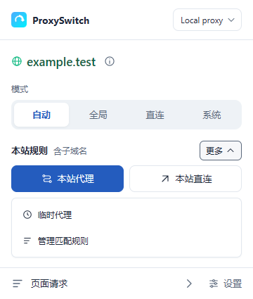
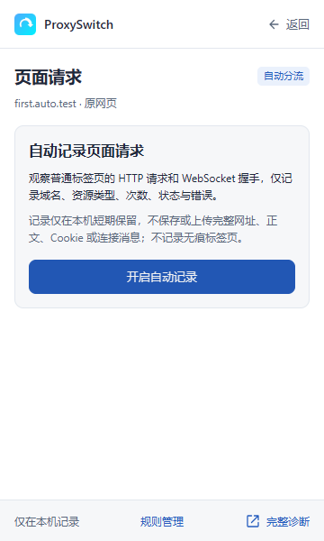
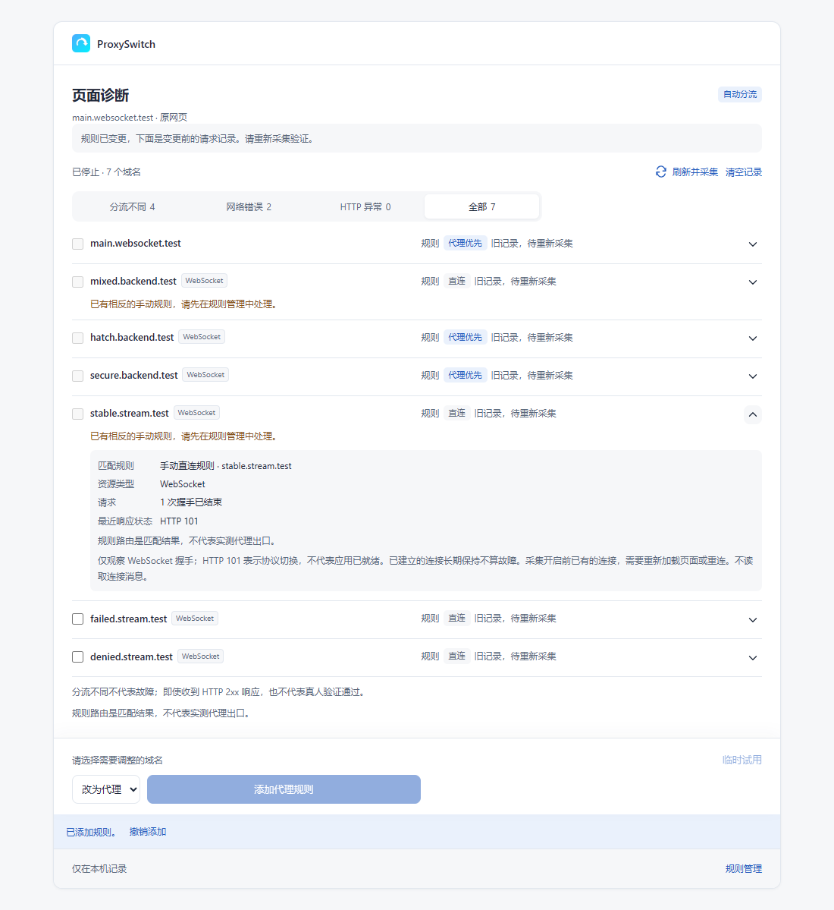
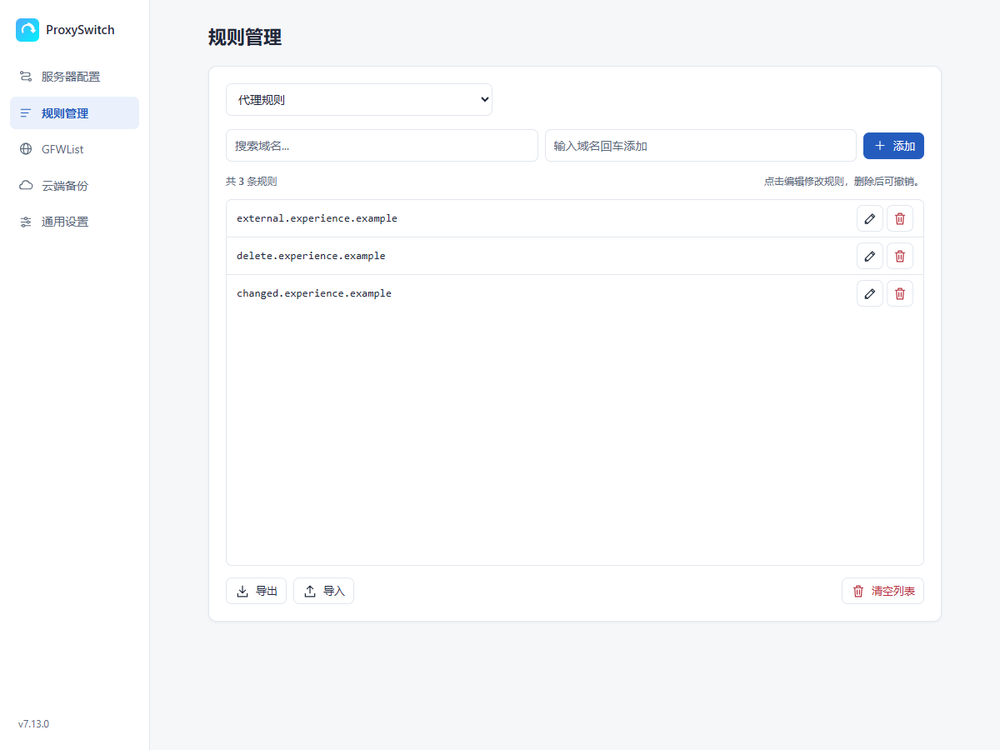
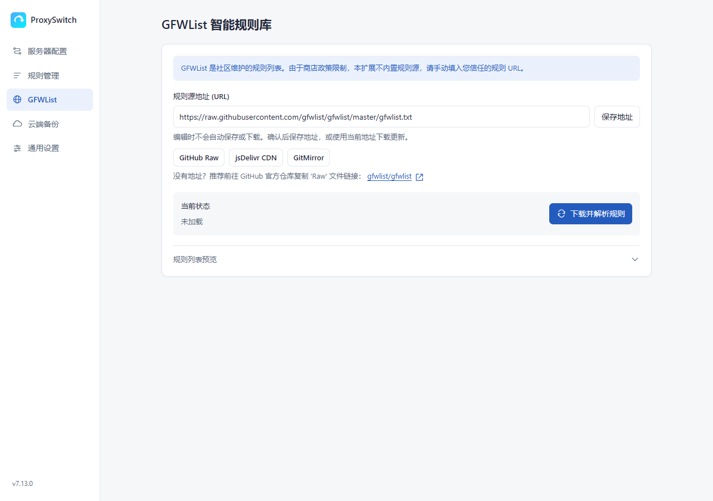

# ProxySwitch

Chrome 代理切换、域名分流与页面请求诊断工具。

A Chrome extension for proxy switching, domain routing, and page request diagnostics.

<!-- 动态读取 main 分支 manifest.json 的版本号 -->


[中文说明](#中文说明) | [English](#english) | [下载 / Download](https://github.com/DMSQ-creator/ProxySwitch/releases/latest) | [更新说明 / Changelog](CHANGELOG.md) | [隐私政策 / Privacy](Privacy.md)

---

## 中文说明

**ProxySwitch** 基于 Chrome Manifest V3，支持自动分流（PAC）、全局代理、直连和系统代理四种模式。您可以在弹窗添加代理或直连规则，查看页面使用的第三方域名，直接批量添加规则，或按需先临时试用。

扩展需要 Chrome 95 或更高版本。它负责管理浏览器代理设置；使用代理前，请先准备可用的代理服务器，例如 Clash 的本地监听地址。

### ✨ 主要功能

*   **🛡️ 多模式切换**：支持自动分流 (PAC)、全局代理、直接连接、系统代理四种模式一键切换。
*   **🤖 智能分流**：
    *   **GFWList 支持**：一键订阅并更新 GFWList 规则。
    *   **自动识别**：根据域名自动判断走代理还是直连。
    *   **代理 / 直连规则**：自定义强制代理域名与强制直连域名（白名单）。
    *   **本站代理 / 本站直连**：弹窗并列提供一键操作，网页仍在加载时也可设置。仅覆盖当前域名及其子域名，规则在自动分流模式下生效。
*   **舒适的紧凑界面**：保留原 Logo，使用统一线性功能图标；弹窗、设置及诊断页支持浅色、深色与实时跟随系统。弹窗首屏突出当前域名、模式和本站两项主要操作；路线图标、彩色域名与详情按钮同一行显示，颜色对应工具栏的规则来源，“更多”按列表展开次要操作。重要提醒仍直接显示。规则可明确编辑、保存或取消，删除后可撤销；失败提示持续显示，未保存的表单草稿不会被后台更新冲掉。
*   **🔎 当前页面请求诊断**：首次明确开启后，自动记录普通标签页当前页面的 HTTP/HTTPS 请求及 WebSocket（WS/WSS）连接握手。之后点击“页面请求”即可查看已有域名、规则线路及错误，无需每次先采集或强制刷新。勾选域名可一键添加代理/直连规则，并撤销本次新增条目；临时试用为可选操作。记录默认关闭，仅在本机短期保留，不读取实时消息内容，也不自动添加规则。
*   **🧰 故障黑匣子**：记录扩展启动、弹窗和代理应用的关键阶段，设置页可复制诊断报告，便于排查扩展自身的故障。
*   **☁️ 云端备份**：
    *   支持 **GitHub Gist** 备份（推荐，免费且稳定）。
    *   支持 **WebDAV** 备份（坚果云、Nextcloud 等）。
    *   配置以可读 JSON 保存到您自己的非公开（secret）GitHub Gist 或 WebDAV；非公开 Gist 不是访问受限的私有仓库，链接持有者仍可访问。同步凭据不会写入备份，配置不会被额外加密。
    *   恢复前可预览覆盖及清空范围，并可撤销上次恢复；恢复后若再次修改配置，不会用旧快照覆盖这些修改。远程 WebDAV 需要 HTTPS，本机回环地址可使用 HTTP。
*   **⚡ 高级特性**：
    *   支持多个代理服务器配置及切换。
    *   当前浏览器线路连通性与耗时测试（不是所选服务器自身的延迟测试）。
    *   支持跟随浏览器语言、简体中文、英文、西班牙语和俄语。

### 📂 目录结构

以下是主要目录结构。安装时请保留整个发布包，避免遗漏页面、语言包或脚本：

```text
ProxySwitch/
├── manifest.json             # 扩展配置与权限
├── CHANGELOG.md              # 中英双语更新说明
├── Privacy.md                # 正式隐私政策
├── _locales/                 # en、zh_CN、es、ru 语言包
├── assets/
│   ├── icon.png              # 扩展主图标
│   ├── icons/                # 各模式的静态图标
│   ├── theme.css             # 共享配色、排版与可访问性
│   ├── popup.css             # 紧凑弹窗样式
│   ├── options.css           # 设置页与窄窗口布局
│   ├── diagnostics.css       # 页面诊断样式
│   └── screenshots/          # README 界面截图
├── html/
│   ├── popup.html
│   ├── options.html
│   └── diagnostics.html
├── js/
│   ├── configuration.js      # 导入与备份配置校验
│   ├── configuration-store.js # 共享配置写入队列
│   ├── cloud-sync.js         # 备份、恢复预览与本地撤销
│   ├── background.js         # 后台与代理设置
│   ├── popup.js
│   ├── options.js
│   ├── ui.js                 # 系统主题与本地线性图标
│   ├── utils.js
│   ├── routing.js            # PAC 与诊断共享的规则匹配
│   ├── request-recorder.js   # 经明确同意后自动记录页面请求
│   ├── diagnostics-background.js
│   ├── diagnostics.js
│   ├── diagnostics-i18n.js
│   ├── logger.js             # 故障黑匣子
│   ├── page-boot.js          # 页面早期启动记录
│   └── icon-data.js          # 预生成图标数据
├── tests/                    # 自动化测试，仅源代码仓库包含
└── tools/                    # 开发工具，仅源代码仓库包含
```

### 🚀 安装指南

从 GitHub 安装时，使用浏览器的“加载已解压的扩展程序”：

1.  **获取代码**
    打开[最新发布页](https://github.com/DMSQ-creator/ProxySwitch/releases/latest)，在 Assets 中下载 `ProxySwitch-v版本号.zip` 并解压。开发者也可以克隆仓库：
    ```bash
    git clone https://github.com/DMSQ-creator/ProxySwitch.git
    ```

2.  **打开扩展管理页**
    在 Chrome 地址栏输入以下地址并回车：
    ```text
    chrome://extensions/
    ```

3.  **开启开发者模式**
    点击页面右上角的开关，开启 **开发者模式 (Developer mode)**。

4.  **加载扩展**
    点击左上角的 **加载已解压的扩展程序 (Load unpacked)** 按钮。

5.  **选择文件夹**
    在弹出的窗口中，选择包含 `manifest.json` 的 `ProxySwitch` 文件夹即可。

**更新已有的本地安装：** 下载新版并解压，将新版文件覆盖到原先加载的目录，再到 `chrome://extensions/` 点击 ProxySwitch 的重新加载按钮。使用 Git 克隆安装的用户可更新仓库后重新加载。保留原目录和已安装的扩展即可沿用配置；更新前也可在设置页备份规则或配置。

### 📖 使用说明

1.  **配置服务器**：
    *   安装后，点击扩展图标或右键选择“选项”。
    *   进入“服务器配置”，添加你的 SOCKS5 或 HTTP 代理服务器地址。
    *   选择要使用的服务器；“测试当前线路”检查浏览器当前线路到测试目标的连通情况，不会单独测量列表中各服务器的延迟。

2.  **切换模式**：
    *   点击浏览器右上角的扩展图标打开 Popup 面板。
    *   **🤖 自动分流**：根据规则判断（推荐日常使用）。
    *   **🚀 全局代理**：浏览器使用所选代理服务器，不按扩展的域名列表分流。
    *   **🛡️ 直接连接**：浏览器使用直连模式。
    *   **💻 系统代理**：浏览器遵循操作系统的代理配置。

    系统代理与自动分流是两个独立模式。自动分流中，匹配代理规则的请求发往所选服务器，未匹配的请求默认直连；第三方域名不会自动跟随主站。

3.  **添加规则**：
    *   在弹窗添加当前域名及其子域名的永久代理规则，或点击“本站直连”加入白名单；不会自动扩大到上级域名。
    *   弹窗的路线图标与域名颜色表示规则判断，不代表实际网络出口；颜色区分匹配来源，与工具栏图标对应。完整域名及规则说明可悬停查看，点击域名后的详情按钮查看匹配来源及完整作用范围；长域名在首屏省略显示，不挤压操作按钮。本站规则标题旁的“更多”按列表提供临时代理、移除与规则管理；保存失败、上级规则覆盖和非自动模式的生效条件不会隐藏。
    *   普通“临时”代理规则在本次浏览器会话内有效，浏览器启动时清理，不参加云备份。它与诊断中的 10 分钟试用规则不同。
    *   “本站直连”适用于当前域名及其子域名；移除本站直连不会删除原有代理规则。如果只有本站直连规则，点击“本站代理”可一次替换；若存在上级直连规则，请进入规则管理调整，避免影响其他网站。
    *   域名规则在自动分流模式下生效。白名单优先于代理规则，本地地址优先直连；可在“规则管理”中处理已有规则及冲突。
    *   规则列表提供明确的编辑、保存和取消按钮，支持 Enter 保存、Esc 取消；删除或清空后可撤销最近一次操作。若列表已被其他页面改动，不会用旧记录覆盖新配置。
    *   订阅地址输入后点击“保存地址”，或点击“下载并解析规则”保存地址并更新规则；输入过程中不会逐字保存或打断焦点。

4.  **云端备份**：
    *   在设置页面的“云端备份”中，填入 GitHub Token 或 WebDAV 信息即可备份/恢复配置。
    *   编辑后点击“保存设置”；也可直接上传或恢复，操作前会先保存当前备份设置。使用自动备份前，请先保存服务、凭据和自动上传选项。

5.  **语言与主题**：
    *   打开“设置 → 通用设置”，选择语言及跟随系统、浅色或深色主题。
    *   语言选择优先于浏览器默认语言；例如 Chrome 使用英文时，仍可将插件设置为简体中文。
    *   如果其他栏目还有未保存草稿，切换语言会先保存选择并提示刷新，不会直接丢弃输入；先保存或取消草稿，再刷新应用新语言。

### 图标含义

工具栏图标表示当前模式，或自动分流中当前页面主域名的规则结果。页面内的第三方请求可能使用其他线路，可在“页面请求”中查看。

| 图标 | 含义 |
| --- | --- |
|  紫色 G | 全局代理 |
|  蓝色 D | 直接连接 |
|  灰色 S | 系统代理 |
|  灰色 A | 自动模式默认直连，或尚无可识别的页面域名 |
|  绿色 A | 自动模式命中订阅代理规则 |
|  蓝色 W | 自动模式命中白名单、本地直连或诊断直连试用 |
|  橙色 T | 自动模式命中临时代理列表或诊断代理试用 |
|  紫色 M | 自动模式命中手动代理规则 |

### 🔎 排查页面的跨域请求

页面可能同时使用主站、验证码、登录、接口及静态资源等多个域名。自动分流按每个请求的目标域名匹配规则，不会让第三方域名自动跟随主站。

1. 在普通 HTTP/HTTPS 页面打开扩展，点击“页面请求”。首次点击“开启自动记录”，阅读页面内的观察范围及本机保留说明，并允许可选的请求观察权限。默认关闭；升级前已经授予该权限的用户也需明确开启，不会静默扩大观察范围。无痕及浏览器内部页面不支持。
2. 开启后正常使用网页，扩展会分别记录各普通标签页当前页面的新请求；之后打开“页面请求”即可看到记录。开启和查看不会自动刷新网页或切换代理模式。开启前的请求无法补查，已有 WebSocket 连接需重新连接才能观察握手；需要时可自行点击“刷新网页”。详细页始终查看原标签页，不将自身作为记录目标。
3. 默认查看“全部”域名，网络错误及 HTTP 异常优先显示；也可筛选“网络错误”“HTTP 异常”或“分流不同”。勾选域名，选择代理或直连，点击“添加代理规则”或“添加直连规则”即可保存并应用，无需先试用或再次确认。观察可在各代理模式下使用，添加和试用规则则需要自动分流模式；扩展不会替您切换模式，已有手动规则冲突需先处理。
4. 添加后可撤销最近一次新增批次，最多保留 10 分钟。撤销只移除本次真正新增的条目，保留原规则；对应列表后来被修改时拒绝旧撤销。直接添加和撤销不会自动刷新原网页，避免丢失输入；可自行返回网页刷新或重连验证。规则已保存但代理应用失败时，可重试应用或安全撤销。原页面变化后撤销入口可能不再显示；清空关联记录会移除该入口，不删除已保存规则。存在试用或尚未确认的代理应用时，先完成对应操作才能清空。
5. 不确定某个域名是否需要代理时，可选“临时试用”，确认后应用试用并刷新原网页，验证后直接保存正式规则，不再要求额外勾选或二次确认。试用最长 10 分钟，撤销只删除本次试用，不还原或覆盖期间修改的正式配置。
6. “清空记录”只清当前页面的摘要，后续新请求仍会记录；“关闭记录”停止自动观察并清除自动记录缓存，但不删除正式规则、已有试用或有效的新增规则撤销记录。也可在浏览器的扩展权限设置中撤销请求观察权限。若保存开关失败，页面会提示错误，请重试或撤销权限，不要将未确认操作视为永久关闭。

**请注意：**

* 显示的是依据 ProxySwitch 规则计算的线路，并非对实际出口 IP 的探测；代理回退及 Clash 内部规则也可能影响最终线路。
* 请求失败不一定需要代理，HTTP 成功也不代表验证码或登录验证通过。分流不同只是排查线索，不会自动添加规则。
* WebSocket 只观察建立连接时的握手，不读取消息或记录连接关闭。HTTP 101 表示协议切换/握手成功，不保证聊天或其他业务已经就绪；已建立的长连接持续存在不是请求失败。
* 只显示浏览器请求观察接口实际提供的事件，不保证覆盖所有资源或找出全部故障。后台重新启动、请求取消或长时间没有终结事件时，结果显示为“未确认”，不当作网络失败。规则变化前的记录会标为旧记录，新请求可重新验证。
* **域名规则不是按标签页隔离的：试用与保存都会影响其他页面对同一域名及其子域名的访问。**
* 自动记录最多保留 20 个标签页上下文、每页 200 个域名、合计 2,000 个域名、1,000 个进行中请求，请求摘要缓存上限为 680 KiB；达到限制时会丢弃部分记录，不形成长期浏览时间线。当前页导航变化或标签页关闭会清理对应旧记录，每页最后一次观察活动后 30 分钟到期。
* 摘要仅含域名、资源类型、计数、HTTP 状态、错误及必要时间、标签页、会话/请求和文档标识，不保存完整 URL、Cookie、请求头、请求正文或 WebSocket 消息。自动记录及其域名选择状态使用浏览器会话内存存储（`chrome.storage.session`），浏览器重启、扩展重新加载或更新会清空缓存。较旧浏览器或会话存储不可用时仅暂存内存，后台重启可能丢失记录；扩展仍支持 Chrome 95 起的浏览器。
* 自动记录开关仅保存在本机；请求摘要不进入故障黑匣子、配置导出或云备份，临时试用及本地新增规则撤销记录也不参加导出/备份。您主动添加或保存的正式规则仍遵循原有的配置备份/同步行为。
* 为兼容旧流程，单次手动采集仍支持只观察选中标签页最多 60 秒，其本地摘要保留最多 30 分钟。新版正常使用“开启自动记录”即可，无需反复开始单次采集。

例如，主站 `www.69shuba.com` 走代理时，验证码域名 `challenges.cloudflare.com` 仍会单独匹配规则。开启记录后重现问题，在“页面请求”选择相关域名直接添加代理规则，或先临时试用，再回到网页实际验证；扩展不会自动为所有 Cloudflare 请求添加代理规则，也不保证验证码通过。

类似地，`muse.ai` 的实时后台连接可能使用 `hatch.metaaivm.com`，主站代理规则不会覆盖这个不同根域。采集到该 WebSocket 域名后，可勾选并直接添加代理规则，也可先临时试用；扩展不内置或自动添加这些网站的代理规则。

### 故障排查与反馈

如果扩展弹窗无响应或代理切换异常：

1. 右键扩展图标打开“选项”，进入“通用设置 → 故障黑匣子”。弹窗打不开时，也可从 `chrome://extensions/` 中的扩展详情进入扩展选项。
2. 如需复现，勾选“记录成功操作的性能耗时”，重现问题后点击“复制诊断报告”。
3. 在 [GitHub Issues](https://github.com/DMSQ-creator/ProxySwitch/issues) 中提供浏览器及扩展版本、代理模式、复现步骤和报告。如果页面也无法打开，可同时提供扩展管理页显示的错误信息。

黑匣子报告显示最近 500 条运行事件和 20 次 Worker 启动记录，仅保存在本机。报告不包含服务器、规则或 PAC 正文，并会隐藏密码、Token 和完整网页 URL。配置读取失败时，设置页会进入只读诊断模式，以保护现有设置；仍可尝试复制报告，然后重新打开设置页。

云操作的耗时和结果默认记录，无需开启详细性能日志；正常网络等待不会被标为性能警告，真正失败或超时仍会报警。

### 权限与隐私

| 权限 | 用途 |
| --- | --- |
| `proxy` | 切换浏览器代理模式、应用所选服务器与 PAC 分流规则 |
| `storage` | 本地保存服务器、规则、界面偏好及诊断摘要 |
| `tabs` | 获取当前页面域名、关联各标签页当前页面的记录，并在用户操作时刷新或返回原页面 |
| `alarms` | 清理到期的页面摘要、未确认请求、试用及恢复预览，结束兼容手动采集，并检查用户开启的自动备份待上传状态 |
| `webRequest`（可选） | 首次开启时申请；仅在明确开启自动记录后只读观察普通标签页当前页面的请求，也支持用户发起的兼容手动采集 |
| HTTP/HTTPS/WS/WSS 主机访问 | HTTP/HTTPS 用于订阅、测试与备份；四种协议配合可选请求观察权限，在用户开启诊断后观察请求及实时连接握手 |

页面请求自动记录默认关闭。开启后的域名及状态摘要属于浏览活动数据，仅为可见的分流诊断功能在本机短期处理，不上传开发者或云备份；不会自动新增规则。云备份由用户主动配置，使用可读 JSON，GitHub Token 和 WebDAV 认证凭据不会写入备份；备份没有额外加密。完整说明见[隐私政策](Privacy.md)。

自动记录使用现有权限，不新增 `webRequestBlocking`、`debugger` 或 `history` 权限；最低浏览器版本仍为 Chrome 95。

**Chrome 商店权限理由与披露：**

* `webRequest`：用于用户明确开启的“页面请求”分流诊断，只读观察普通标签页的 HTTP/HTTPS 请求与 WS/WSS 握手，将域名、资源类型、计数、状态和错误汇总为短期本机记录，帮助用户发现第三方连接问题并自行添加代理或直连规则。不读取 Cookie、正文或实时消息，不拦截/修改请求，不上传观察记录。可随时关闭；已有权限并不会自动开启记录。
* `alarms`：用于清理到期的本机请求摘要及未确认状态、结束手动采集、到期诊断试用和恢复预览，并检查用户已开启的自动备份待上传状态；不自行开启请求观察，也不用于持续唤醒后台。
* 商店“隐私权规范”、功能介绍及隐私政策应一致披露上述本机浏览活动处理，不能因“不上传”而声明“不访问用户数据”。政策链接使用本仓库的 `Privacy.md`。此说明用于准备审核材料，不代表 Chrome 商店保证批准。

---

## English

**ProxySwitch** is a Chrome Manifest V3 extension with four modes: Auto (PAC), Global Proxy, Direct, and System Proxy. Add proxy or direct rules from the popup, inspect third-party domains used by a page, and add selected domain rules directly or optionally try temporary routing changes first.

Requires Chrome 95 or later. The extension manages the browser's proxy settings; configure a working proxy server first, such as Clash's local listening address.

### ✨ Key Features

*   **🛡️ Multi-Mode Switching**: One-click switching between Auto Switch (PAC), Global Proxy, Direct Connection, and System Proxy modes.
*   **🤖 Smart Routing**:
    *   **GFWList Support**: Subscribe to and update GFWList rules with one click.
    *   **Auto Detection**: Automatically decides whether to proxy or connect directly based on the domain.
    *   **Proxy / Direct Rules**: Custom forced-proxy domains and forced-direct domains (the direct list).
    *   **Proxy / Direct for This Site**: Side-by-side popup actions remain available while a page is loading. Rules cover only the current hostname and its subdomains and apply in Auto mode.
*   **Comfortable, Compact Interface**: The original logo is retained, with consistent line icons for actions. Popup, Options, and diagnostics share Light, Dark, and live System themes. The popup highlights the current hostname, mode, and two main site actions. The route icon, colored hostname, and details control share one row, using colors corresponding to the toolbar's rule sources; **More** expands secondary actions as a list. Important warnings remain visible. Rules have explicit edit/save/cancel controls and deletion undo. Failures remain visible, and background updates do not erase unsaved form drafts.
*   **🔎 Page Request Diagnostics**: Explicitly enable automatic recording once to observe HTTP/HTTPS requests and WebSocket (WS/WSS) handshakes from the current pages of normal tabs. Afterwards, open **Page requests** to inspect already-recorded domains, predicted rule routes, and errors without starting a capture or forcing a reload each time. Select domains to add proxy/direct rules in one click, with undo for new entries and optional temporary trials. Recording is off by default; short-lived records stay on your device, real-time messages are not read, and rules are never added automatically.
*   **🧰 Fault Black Box**: Records key extension startup, popup, and proxy-application milestones. Copy a diagnostic report from Options to help troubleshoot extension failures.
*   **☁️ Cloud Backup**:
    *   Supports **GitHub Gist** backup (Recommended).
    *   Supports **WebDAV** backup (Nextcloud, etc.).
    *   Configurations are readable JSON in your own secret GitHub Gist or WebDAV service. A secret Gist is not access-restricted: anyone with its link can view it. Sync credentials are excluded and backups are not additionally encrypted.
    *   Preview replacement/clearing before restoring, and undo the last restore locally. Later edits cannot be overwritten by an old snapshot. Remote WebDAV requires HTTPS; loopback servers may use HTTP.
*   **⚡ Advanced Features**:
    *   Configure and switch between multiple proxy servers.
    *   Connectivity and timing checks for the current browser route, not independent latency tests of the selected server.
    *   Follow the browser language, or choose Simplified Chinese, English, Spanish, or Russian.

### 📂 Directory Structure

The main directory structure is shown below. Keep the complete release package when installing so that pages, language packs, and scripts are available:

```text
ProxySwitch/
├── manifest.json             # Extension configuration and permissions
├── CHANGELOG.md              # Bilingual release notes
├── Privacy.md                # Official privacy policy
├── _locales/                 # en, zh_CN, es, ru language packs
├── assets/
│   ├── icon.png              # Main extension icon
│   ├── icons/                # Static mode icons
│   ├── theme.css             # Shared palette, typography and accessibility
│   ├── popup.css             # Compact popup styles
│   ├── options.css           # Options and narrow-window layouts
│   ├── diagnostics.css       # Request inspector styles
│   └── screenshots/          # README screenshots
├── html/
│   ├── popup.html
│   ├── options.html
│   └── diagnostics.html
├── js/
│   ├── configuration.js      # Import and backup validation
│   ├── configuration-store.js # Shared configuration mutation queue
│   ├── cloud-sync.js         # Backup, restore preview and local undo
│   ├── background.js         # Background and proxy settings
│   ├── popup.js
│   ├── options.js
│   ├── ui.js                 # System theme and local line icons
│   ├── utils.js
│   ├── routing.js            # Shared PAC/diagnostic matching
│   ├── request-recorder.js   # Consent-gated automatic page request recording
│   ├── diagnostics-background.js
│   ├── diagnostics.js
│   ├── diagnostics-i18n.js
│   ├── logger.js             # Fault black box
│   ├── page-boot.js          # Early page startup records
│   └── icon-data.js          # Pre-generated icon data
├── tests/                    # Automated tests; source repository only
└── tools/                    # Development tools; source repository only
```

### 🚀 Installation Guide

For installation from GitHub, use your browser's **Load unpacked** option:

1.  **Download Code**
    Open the [latest release](https://github.com/DMSQ-creator/ProxySwitch/releases/latest), download `ProxySwitch-vVERSION.zip` from Assets, and extract it. Developers can also clone the repository:
    ```bash
    git clone https://github.com/DMSQ-creator/ProxySwitch.git
    ```

2.  **Open Extensions Page**
    Type the following in your Chrome address bar:
    ```text
    chrome://extensions/
    ```

3.  **Enable Developer Mode**
    Toggle on **Developer mode** in the top right corner.

4.  **Load Extension**
    Click the **Load unpacked** button in the top left corner.

5.  **Select Folder**
    Select the `ProxySwitch` folder containing the `manifest.json` file.

**Update an existing unpacked installation:** Download and extract the new release, copy its files into the directory originally loaded, then click ProxySwitch's reload button on `chrome://extensions/`. Git installations can update the repository and reload the extension. Keeping the original directory and installed extension preserves its settings; you can also back up rules or configuration in Options before updating.

### 📖 Usage

1.  **Configure Server**:
    *   After installation, click the extension icon or right-click and select "Options".
    *   Go to "Server Configuration" and add your SOCKS5 or HTTP proxy server.
    *   Select the server to use. **Test Current Route** checks the browser's current route to the test target; it does not independently measure the listed servers' latency.

2.  **Switch Modes**:
    *   Click the extension icon to open the Popup panel.
    *   **🤖 Auto Switch**: Routes traffic based on rules (Recommended).
    *   **🚀 Global Proxy**: Uses the selected proxy server without the extension's domain-list routing.
    *   **🛡️ Direct**: Uses the browser's direct connection mode.
    *   **💻 System Proxy**: Follows the operating system's proxy settings.

    System Proxy and Auto are separate modes. In Auto, proxy-rule matches use the selected server, while unmatched requests default to direct. Third-party domains do not automatically follow the main site.

3.  **Add Rules**:
    *   Add a permanent proxy rule for the current hostname and its subdomains from the popup, or choose **Direct for this site** to add it to the direct list. The scope is not automatically broadened to a parent hostname.
    *   The route icon and hostname color describe rule-based routing, not the actual network exit. Colors distinguish matching sources and correspond to the toolbar icons. Hover for the full hostname and rule explanation, or open the details control beside the hostname to inspect the matched source and full scope. Long hostnames are shortened visually without squeezing the controls. **More**, beside the site-rule heading, expands a list for temporary proxy, removal, and rule management. Save failures, inherited-rule overrides, and the Auto-mode requirement remain visible without expanding details.
    *   Ordinary temporary proxy rules last for the current browser session, are cleared on browser startup, and are excluded from cloud backups. They differ from 10-minute diagnostic trials.
    *   Direct-list entries cover the hostname and its subdomains. Removing the site's direct entry preserves existing proxy rules. **Proxy for this site** can replace an exact direct entry in one operation. An inherited parent direct rule must be adjusted in Rule Management to avoid silently affecting other sites.
    *   Domain rules apply in Auto mode. The direct list takes priority over proxy rules, and local addresses bypass the proxy first. Manage existing rules and conflicts in **Rule Management**.
    *   Rule lists provide explicit edit/save/cancel controls, including Enter to save and Esc to cancel. Undo the latest deletion or clear operation; changes made by another page are not overwritten by an old snapshot.
    *   After entering a subscription URL, choose **Save address**, or **Download & Parse** to save it and update the rules. Typing does not save each keystroke or interrupt focus.

4.  **Cloud Backup**:
    *   In the Options page under "Cloud Backup", enter your GitHub Token or WebDAV details to backup or restore your configuration.
    *   Choose **Save settings**, or upload/restore to save current backup settings before the operation. Save the provider, credentials, and auto-upload preference before using automatic backup.

5.  **Language and Theme**:
    *   Open **Options → General** to select a language and System, Light, or Dark theme.
    *   The extension's language setting overrides the browser default. For example, an English Chrome installation can still display the extension in Simplified Chinese.
    *   If another section contains unsaved drafts, changing the language saves the preference and offers an explicit refresh instead of discarding input. Save or cancel those drafts before refreshing.

### Toolbar Icon Guide

Icons show the selected mode, or the current page's main-hostname rule result in Auto. Third-party requests on the page may use other routes; inspect them under **Page requests**.

| Icon | Meaning |
| --- | --- |
|  Purple G | Global Proxy |
|  Blue D | Direct |
|  Gray S | System Proxy |
|  Gray A | Auto default direct, or no identifiable page hostname yet |
|  Green A | Auto match from subscription proxy rules |
|  Blue W | Auto direct-list match, local bypass, or diagnostic direct trial |
|  Orange T | Auto temporary proxy-list match or diagnostic proxy trial |
|  Purple M | Auto match from manual proxy rules |

### 🔎 Diagnose Cross-Domain Page Requests

A page may use separate domains for the main site, challenges, sign-in, APIs, and static resources. Auto mode matches each request's destination domain; third-party domains do not automatically follow the main site's route.

1. Open the extension on a normal HTTP/HTTPS page and select **Page requests**. On first use, choose **Enable automatic recording**, review the displayed observation scope and local-retention notice, and allow the optional request-observation permission. Recording is off by default. An earlier permission grant is not consent to automatic recording: upgrading users must explicitly enable it too. Incognito and internal browser pages are excluded.
2. Use your pages normally. New requests are recorded separately for each normal tab's current page; opening **Page requests** afterwards shows its existing records. Enabling or viewing does not reload the page or switch proxy modes. Earlier requests cannot be recovered, and existing WebSocket connections need a new handshake to be observed. Choose **Reload page** yourself if needed. The detailed view stays bound to the source tab, not its own extension page.
3. **All** is the default filter, with network and HTTP errors prioritized. Filter by **Network errors**, **HTTP errors**, or **Different route** as needed. Select domains, choose proxy or direct, and click **Add proxy rules** or **Add direct rules** to save and apply them without a required trial or second confirmation. Observation works in all proxy modes; adding and trying domain rules requires Auto mode. The extension does not switch modes for you. Resolve existing manual-rule conflicts first.
4. Undo the latest addition for up to 10 minutes. Undo removes only entries actually added by that batch, preserving existing rules; later edits to the affected list prevent a stale undo. Direct addition and undo do not reload the source page automatically, protecting drafts. Return to the page and reload or reconnect when ready to verify. If rules are saved but proxy application fails, retry application or safely undo the addition. Navigating away may hide the undo control; clearing associated records removes it without deleting permanent rules. Finish active trials or unconfirmed proxy applications before clearing records.
5. If unsure whether a domain needs the proxy, choose **Temporary trial**. Confirming a trial applies it and reloads the source page. Verify the result, then save permanent rules directly without an extra checkbox or confirmation screen. Trials expire after at most 10 minutes. Undo removes only the trial and does not restore an older configuration snapshot.
6. **Clear records** removes only the current page's summaries; later requests are still recorded. **Disable** stops automatic observation and clears automatic caches, without deleting permanent rules, active trials, or valid rule-addition undo records. You can also revoke request-observation permission in the browser's extension settings. If saving the preference fails, the UI reports an error; retry or revoke permission rather than treating an unconfirmed operation as permanently disabled.

**Important limits:**

* Routes are predictions from ProxySwitch rules, not measurements of the actual exit IP. Proxy fallback and Clash's own rules may affect the final connection.
* A failed request does not necessarily need a proxy, and an HTTP success does not prove a challenge or sign-in succeeded. Different routes are clues, not automatic rule recommendations.
* WebSocket observation covers only the connection handshake, not messages or connection closure. HTTP 101 means a protocol upgrade/successful handshake, not that chat or another application is ready. An established long-lived connection is not a failed request.
* Only events provided by the browser's request-observation API can be shown; coverage is not exhaustive and the tool cannot identify every fault. After background restarts, request cancellation, or a long wait without a terminal event, the outcome is **unconfirmed**, not a network failure. Records observed before a rule change are marked older; new requests can verify the change.
* **Domain rules are not tab-isolated: trials and saved rules also affect other pages requesting the same domain and its subdomains.**
* Automatic recording is bounded to 20 tab contexts, 200 domains per page, 2,000 domains overall, 1,000 in-flight requests, and a 680 KiB request-summary cache. Limits can discard records; this is not a long-term browsing timeline. Navigation changes and tab closure remove the corresponding previous-page records, and each page expires 30 minutes after its last observed activity.
* Summaries contain domains, resource types, counts, HTTP statuses, errors, and necessary timestamps, tab/session/request and document identifiers—not full URLs, cookies, request headers, bodies, or WebSocket messages. Automatic records and their domain-selection state use browser-session memory storage (`chrome.storage.session`), cleared by browser restart, extension reload, or update. Older browsers or unavailable session storage use bounded memory only, which can lose records on background restart; Chrome 95 remains supported.
* The automatic-recording preference is local only. Request summaries do not enter the fault black box, configuration export, or cloud backup. Temporary trials and local rule-addition undo records are also excluded from export/backup. Permanent rules you explicitly add or save follow the existing configuration backup/sync behavior.
* For compatibility, the legacy manual-capture flow remains supported: one selected tab for up to 60 seconds, with local summaries retained for up to 30 minutes. Normal use of the new UI only needs **Enable automatic recording** once, not repeated manual captures.

For example, when `www.69shuba.com` uses the proxy, the challenge domain `challenges.cloudflare.com` still matches rules independently. Enable recording, reproduce the issue, then select the relevant domain in **Page requests** to add a proxy rule directly or try it temporarily. Return to the page to verify the result. The extension does not automatically proxy every Cloudflare request or guarantee that verification will pass.

Similarly, `muse.ai` may connect to its real-time backend at `hatch.metaaivm.com`, which is a different root domain and is not covered by the main-site rule. After capturing that WebSocket domain, select it to add a proxy rule directly or try a temporary rule first. The extension does not bundle or automatically add proxy rules for these sites.

### Troubleshooting and Feedback

If the popup does not respond or proxy switching fails:

1. Right-click the extension icon, open **Options**, and go to **General → Fault Black Box**. If the popup will not open, you can also open extension options from its details on `chrome://extensions/`.
2. To reproduce an issue, enable **Record timing for successful operations**, reproduce it, then click **Copy Diagnostic Report**.
3. In [GitHub Issues](https://github.com/DMSQ-creator/ProxySwitch/issues), include your browser and extension versions, proxy mode, reproduction steps, and the report. If the options page also fails to open, include any errors shown on the extensions management page.

Reports show the latest 500 runtime events and 20 worker boots, stored on your device. They exclude server, rule, and PAC contents and redact passwords, tokens, and full page URLs. When configuration cannot be read, Options enters a read-only diagnostic mode to protect existing settings; you can still try copying the report and reopen Options to retry.

Cloud operation timings and outcomes are recorded by default, without enabling detailed performance logging. Normal network waits are not flagged as performance warnings; actual failures and timeouts are still reported.

### Permissions and Privacy

| Permission | Purpose |
| --- | --- |
| `proxy` | Switch browser proxy modes and apply the selected server or PAC rules |
| `storage` | Store servers, rules, UI preferences, and diagnostic summaries locally |
| `tabs` | Read current hostnames, associate records with each tab's current page, and reload or return to the source page when requested |
| `alarms` | Clean up expired page summaries, unconfirmed requests, trials and restore previews, end legacy manual captures, and check pending user-enabled automatic backups |
| `webRequest` (optional) | Requested on first enable; read-only observation of normal tabs' current-page requests only after explicit consent to automatic recording, plus user-initiated legacy manual captures |
| HTTP/HTTPS/WS/WSS host access | HTTP/HTTPS supports subscriptions, tests, and backups; all four schemes support request/handshake observation after the user enables diagnostics |

Automatic page request recording is off by default. Domain and status summaries processed after consent are browsing-activity data, used briefly on-device for the visible routing-diagnostics feature, not uploaded to the developer or cloud backup. No rules are added automatically. Cloud backup is user-configured readable JSON. GitHub tokens and WebDAV authentication credentials are excluded from backups; backups are not additionally encrypted. See the [privacy policy](Privacy.md) for details.

Automatic recording uses existing permissions without adding `webRequestBlocking`, `debugger`, or `history`. The minimum supported browser remains Chrome 95.

**Chrome Web Store permission justifications and disclosure:**

* `webRequest`: Supports the user-enabled **Page requests** routing-diagnostics feature by observing HTTP/HTTPS requests and WS/WSS handshakes on normal tabs read-only. Destination domains, resource types, counts, statuses and errors become short-lived local summaries, helping users identify third-party connection issues and choose their own proxy/direct rules. Cookies, bodies and real-time messages are not read; requests are not intercepted or modified and observed records are not uploaded. Users can disable recording anytime. A prior permission grant does not enable it.
* `alarms`: Cleans up expired local request summaries and unconfirmed states, ends legacy manual captures, expires diagnostic trials and restore previews, and checks pending uploads for user-enabled automatic backup. It does not independently enable observation or keep the background continuously awake.
* The Store's **Privacy practices**, feature description and privacy policy should consistently disclose this local processing of browsing activity. Local-only processing is not a basis for declaring that no user data is accessed. Use this repository's `Privacy.md` as the policy link. This text supports review preparation and does not guarantee Store approval.

---

## 界面截图 / Screenshots

当前弹窗、展开的次级操作、自动记录首次开启与页面请求面板、WebSocket 诊断、规则管理和 GFWList 设置（简体中文界面，使用示例域名）。

Current popup, expanded secondary actions, automatic-recording consent and request views, WebSocket diagnostics, rule management, and GFWList settings (Simplified Chinese UI, using example domains).

<p>
  
  
</p>
<p>
  
  
</p>
<p>
  
</p>
<p>
  
</p>
<p>
  
</p>

---

## 📝 License

This project is open-sourced under the MIT License.
